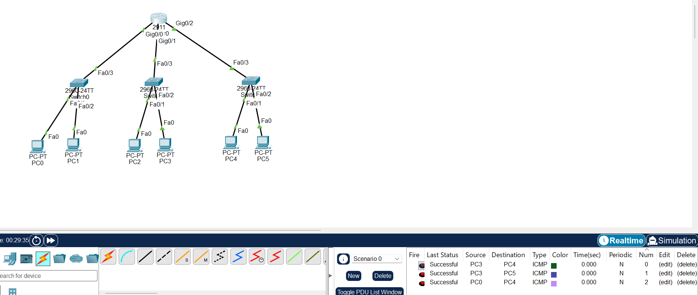
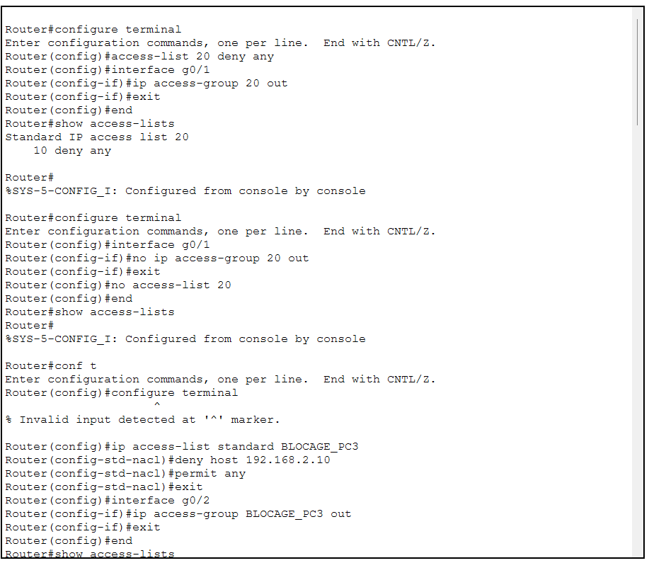
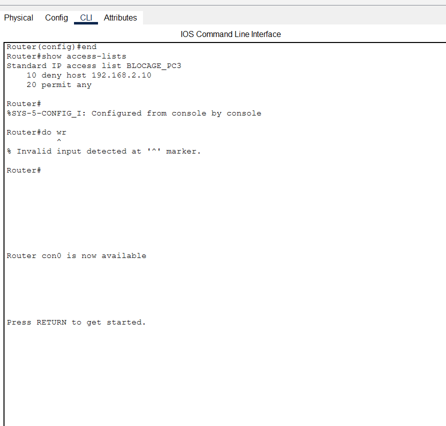
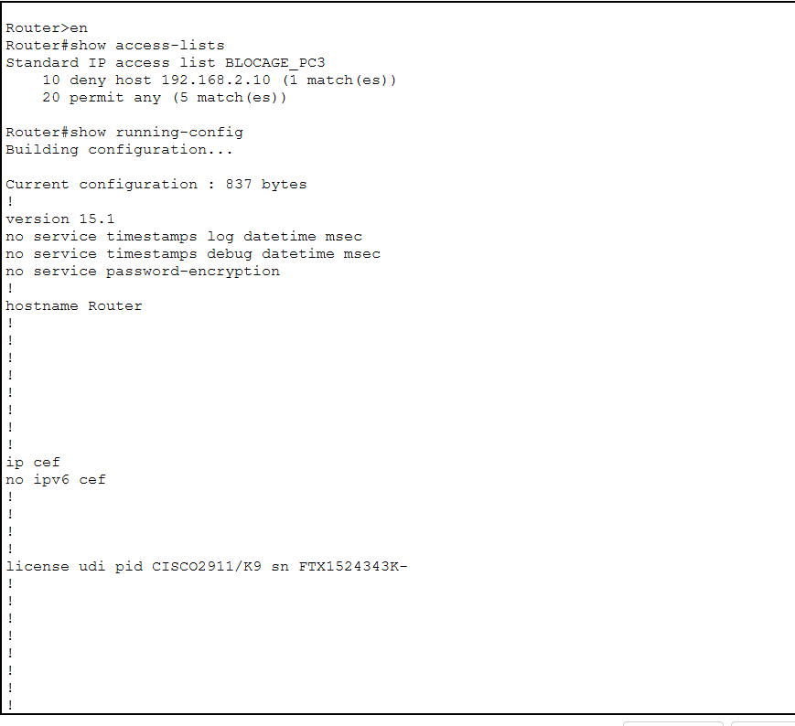
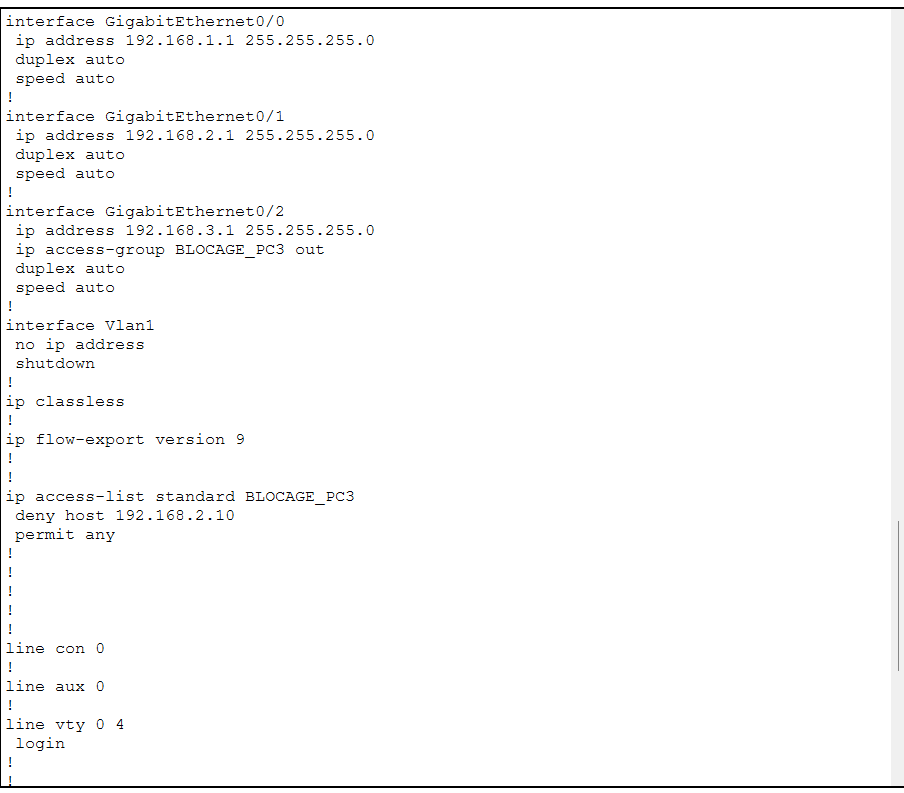

# TP — Mise en œuvre des ACL standard numérotées et nommées (Packet Tracer)

**Objectif** : filtrer le trafic entre trois LAN reliés par un routeur Cisco 2911, à l'aide d'ACL standard : bloquer un réseau entier, isoler complètement un LAN, puis bloquer une seule machine avec une ACL nommée.

**Environnement** : Cisco Packet Tracer 9.0.1 — 1 routeur **2911**, 3 switchs **2960**, 6 PC.



📎 Maquette Packet Tracer : [TP-ACL-Standard.pkt](TP-ACL-Standard.pkt)

## Plan d'adressage

| LAN | Réseau | Passerelle (R1) | PC |
|---|---|---|---|
| Administration | 192.168.1.0/24 | G0/0 : 192.168.1.1 | 192.168.1.10 et 192.168.1.20 |
| Comptabilité | 192.168.2.0/24 | G0/1 : 192.168.2.1 | 192.168.2.10 et 192.168.2.20 |
| Informatique | 192.168.3.0/24 | G0/2 : 192.168.3.1 | 192.168.3.10 et 192.168.3.20 |

Les switchs ne reçoivent **aucune configuration** dans ce TP : ils transmettent les trames entre les PC et le routeur. Toute la logique (routage + filtrage) est dans R1.

## Configuration initiale du routeur

```
enable
configure terminal
interface g0/0
 ip address 192.168.1.1 255.255.255.0
 no shutdown
interface g0/1
 ip address 192.168.2.1 255.255.255.0
 no shutdown
interface g0/2
 ip address 192.168.3.1 255.255.255.0
 no shutdown
end
```

Vérification avant ACL : `show ip interface brief` (3 interfaces up/up), puis pings entre LAN — tout répond.

## Exercice 1 — Bloquer un réseau (ACL numérotée 10)

Interdire au réseau Administration (192.168.1.0/24) d'accéder au LAN Informatique, sans bloquer les autres :

```
configure terminal
access-list 10 deny 192.168.1.0 0.0.0.255
access-list 10 permit any
interface g0/2
 ip access-group 10 out
end
```

Résultats : PC Admin → PC Info **bloqués** · PC Compta → PC Info **autorisés**.

Nettoyage avant l'exercice suivant :

```
configure terminal
interface g0/2
 no ip access-group 10 out
no access-list 10
end
```

## Exercice 2 — Isoler complètement le LAN Comptabilité (ACL numérotée 20)

```
configure terminal
access-list 20 deny any
interface g0/1
 ip access-group 20 out
end
```

Résultats : **tous** les pings vers la Comptabilité sont bloqués, quelle que soit la source. Le `deny any` ne laisse rien passer vers ce LAN.

Nettoyage :

```
configure terminal
interface g0/1
 no ip access-group 20 out
no access-list 20
end
```

## Exercice 3 — Bloquer une seule machine (ACL nommée BLOCAGE_PC3)

Bloquer uniquement la machine 192.168.2.10 vers le LAN Informatique :

```
configure terminal
ip access-list standard BLOCAGE_PC3
 deny host 192.168.2.10
 permit any
exit
interface g0/2
 ip access-group BLOCAGE_PC3 out
end
```

## Vérification finale (réelle, sur la maquette)

`show access-lists` :

```
Standard IP access list BLOCAGE_PC3
    10 deny host 192.168.2.10 (1 match(es))
    20 permit any (5 match(es))
```

Les compteurs prouvent le fonctionnement : le ping de la machine bloquée a été rejeté (1 match sur le deny), le trafic autorisé passe (5 matches sur le permit). Tests PDU : les flux autorisés affichent **Successful**. Aucune trace des ACL 10 et 20 dans la `running-config` finale : les nettoyages entre exercices ont été faits proprement.

## Questions de synthèse

- **Pourquoi appliquer l'ACL 10 en sortie de G0/2 plutôt qu'en entrée de G0/0 ?** Une ACL standard se place au plus près de la **destination** : en sortie de G0/2, un seul point de filtrage protège tout le LAN Informatique, et le trafic du réseau Administration reste libre vers les autres destinations (par exemple la Comptabilité).
- **Rôle du `deny any` (exercice 2) ?** Bloquer absolument tout le trafic à destination du LAN Comptabilité, quelle que soit l'adresse source.
- **`deny host 192.168.2.10` ou `deny 192.168.2.0 0.0.0.255` ?** `host` ne bloque qu'**une seule machine** (/32) ; la seconde forme bloque **tout le sous-réseau** 192.168.2.0/24.
- **Que se passe-t-il si on oublie `permit any` ?** Toute ACL se termine par un **deny implicite** : sans `permit any`, tout le trafic non autorisé explicitement est bloqué, même celui qui devait passer.
- **Peut-on bloquer HTTP avec une ACL standard ?** Non : une ACL standard ne filtre que sur l'**adresse IP source**. Pour filtrer un protocole ou un port (HTTP = TCP 80), il faut une **ACL étendue**.

✅ Terminé — 19/11/2026

## Captures de vérification








