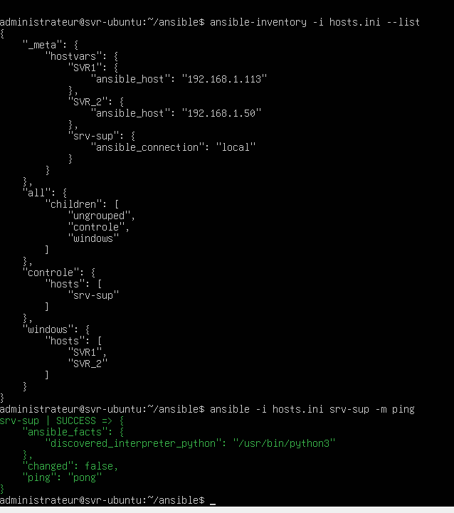
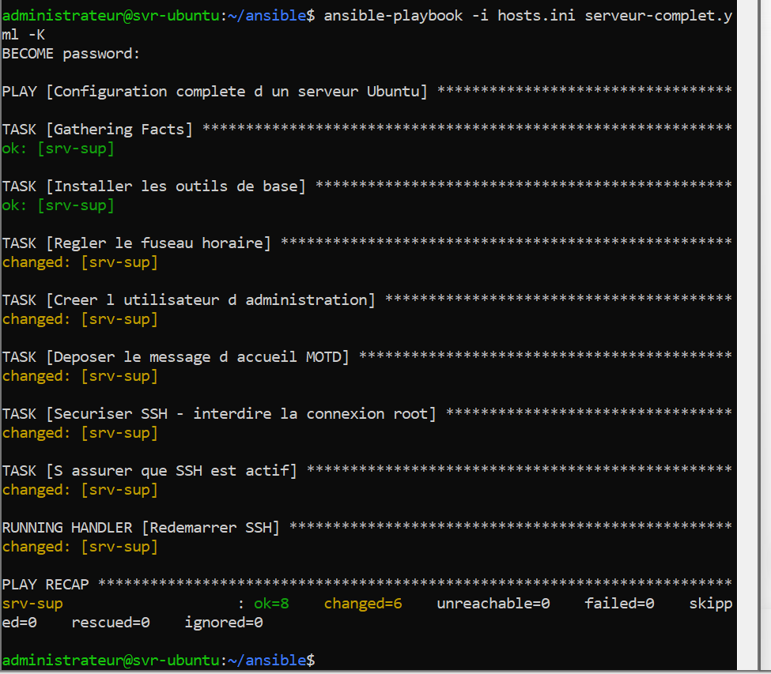
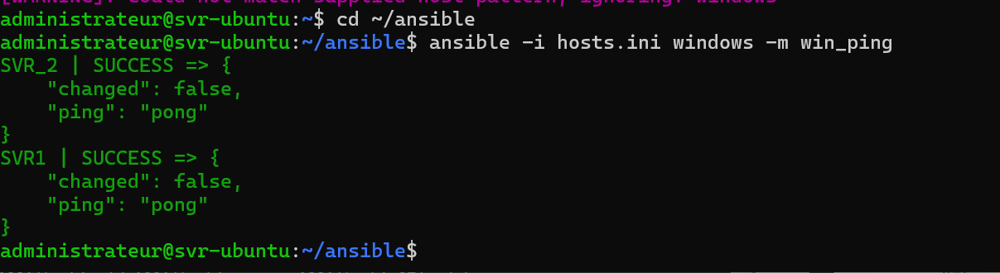
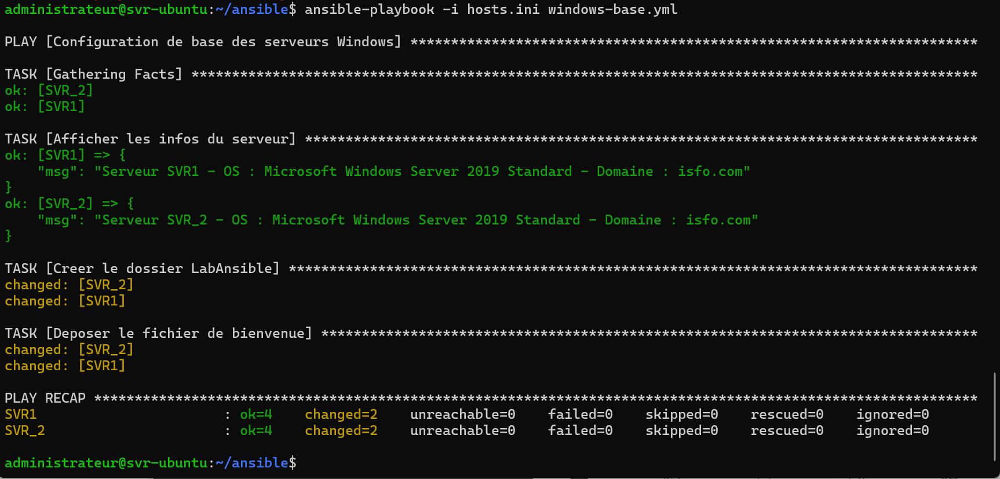
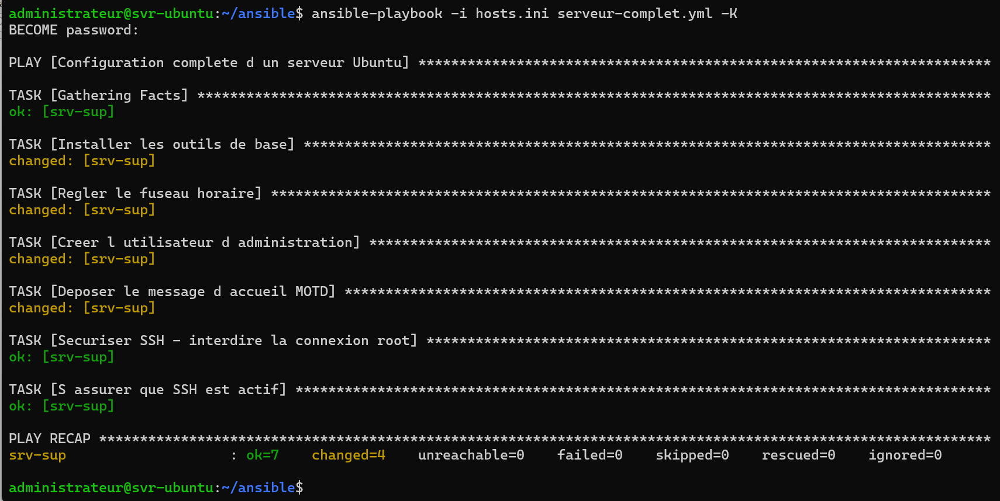
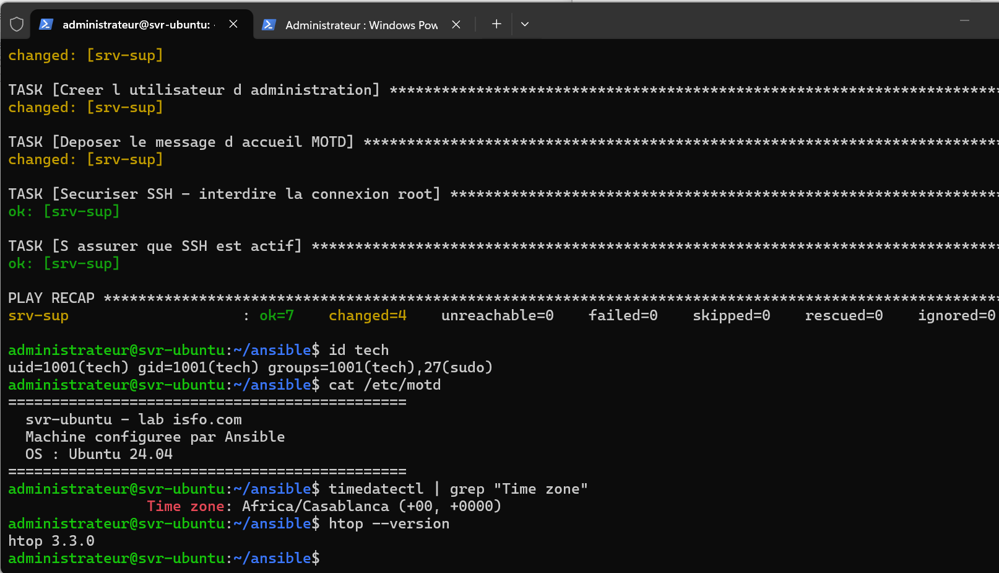

# TP 17 — Automatisation du lab isfo.com avec Ansible (Linux + Windows)

**Date :** 23/11/2026
**Auteure :** Hiba Khaddi — OFPPT, Technicien Spécialisé en Infrastructure Digitale
**Technologies :** Ansible (core 2.16.3), Ubuntu Server 24.04, Windows Server 2019, WinRM, SSH

## Objectif

Mettre en place **Ansible** comme outil d'automatisation (Infrastructure as Code) du lab `isfo.com` : un **nœud de contrôle** Linux pilote les machines du lab et applique des configurations **identiques, reproductibles et idempotentes**, sur Linux **et** sur les serveurs Windows (contrôleurs de domaine), à partir de playbooks YAML versionnables.

> Principe : Ansible ne s'installe pas « à la place » du déploiement — la machine doit démarrer et répondre sur le réseau (SSH pour Linux, WinRM pour Windows). Ensuite, Ansible configure **tout** : paquets, services, utilisateurs, fichiers de configuration, sécurité.

## Environnement

| Machine | Rôle | IP (lab VMnet1) | Système |
|---|---|---|---|
| SRV-SUP (`svr-ubuntu`) | **Nœud de contrôle Ansible** (+ serveur Zabbix) | 192.168.1.53 | Ubuntu Server 24.04.5 |
| SVR1 | Contrôleur de domaine isfo.com | 192.168.1.113 | Windows Server 2019 |
| SVR_2 | Contrôleur de domaine isfo.com (détient les 5 rôles FSMO) | 192.168.1.50 | Windows Server 2019 |

## Phase 1 — Installation et inventaire

- Installation : `sudo apt install -y ansible` → **ansible core 2.16.3** (avec `python3-winrm`, utile pour la phase Windows).
- Inventaire `~/ansible/hosts.ini` :

```ini
[controle]
srv-sup ansible_connection=local

[windows]
SVR1 ansible_host=192.168.1.113
SVR_2 ansible_host=192.168.1.50
```

- Premier test : `ansible -i hosts.ini srv-sup -m ping` → **SUCCESS, « ping »: « pong »**.



## Phase 2 — Playbooks Linux

**Playbook d'information `infos.yml`** : collecte des *facts* (nom d'hôte, OS, adresse IP par défaut) et les affiche via le module `debug`.

**Playbook avancé `serveur-complet.yml`** — configuration complète d'un serveur Ubuntu, avec **variables**, **template Jinja2** et **handler** :

```yaml
---
- name: Configuration complete d un serveur Ubuntu
  hosts: srv-sup
  become: true
  vars:
    utilisateur: tech
    fuseau: Africa/Casablanca
  tasks:
    - name: Installer les outils de base
      ansible.builtin.apt:
        name: [htop, curl, vim, openssh-server]
        state: present
        update_cache: true

    - name: Regler le fuseau horaire
      ansible.builtin.file:
        src: /usr/share/zoneinfo/{{ fuseau }}
        dest: /etc/localtime
        state: link
        force: true

    - name: Creer l utilisateur d administration
      ansible.builtin.user:
        name: "{{ utilisateur }}"
        shell: /bin/bash
        groups: sudo
        append: true

    - name: Deposer le message d accueil MOTD
      ansible.builtin.template:
        src: templates/motd.j2
        dest: /etc/motd

    - name: Securiser SSH - interdire la connexion root
      ansible.builtin.lineinfile:
        path: /etc/ssh/sshd_config
        regexp: '^#?PermitRootLogin'
        line: 'PermitRootLogin no'
      notify: Redemarrer SSH

    - name: S assurer que SSH est actif
      ansible.builtin.service:
        name: ssh
        state: started
        enabled: true

  handlers:
    - name: Redemarrer SSH
      ansible.builtin.service:
        name: ssh
        state: restarted
```

- 1er lancement : **ok=8, changed=6, failed=0** — le **handler** « Redemarrer SSH » se déclenche automatiquement parce que la configuration SSH a changé.
- 2e lancement (même commande) : **changed=0** → **idempotence prouvée** : Ansible constate que tout est déjà conforme et ne modifie rien.



## Phase 3 — Pilotage des serveurs Windows via WinRM

- Activation de WinRM sur SVR1 et SVR_2 (PowerShell administrateur) :

```powershell
winrm quickconfig -force
winrm set winrm/config/service/auth '@{Basic="true"}'
winrm set winrm/config/service '@{AllowUnencrypted="true"}'
```

*(Trafic non chiffré accepté uniquement parce que le lab est isolé en réseau host-only ; en production : HTTPS/Kerberos.)*

- Inventaire complété (le mot de passe n'est **jamais** publié — il est masqué ici) :

```ini
[windows:vars]
ansible_connection=winrm
ansible_winrm_transport=ntlm
ansible_port=5985
ansible_user=Administrateur@isfo.com
ansible_password=********
```

- Test : `ansible -i hosts.ini windows -m win_ping` → **SVR1 : pong ✅, SVR_2 : pong ✅**.



- Premier playbook Windows `windows-base.yml`, appliqué **à l'identique sur les deux DC en une commande** (affichage des infos, création de `C:\LabAnsible`, dépôt de `bienvenue.txt`) : **ok=4, changed=2, failed=0 sur chaque serveur**.



## Phase 4 — Test réel : reconstruction complète en une commande

Test de vérité : la configuration de SRV-SUP est **volontairement détruite** (`userdel` de l'utilisateur tech, suppression du MOTD, fuseau remis à UTC, `apt remove htop`), puis **reconstruite par la seule commande** :

```
ansible-playbook -i hosts.ini serveur-complet.yml -K
```

Résultat : **ok=7, changed=4, failed=0** — Ansible a réparé **exactement les 4 éléments détruits** (outils, fuseau Africa/Casablanca, utilisateur tech, MOTD) et laissé intacts ceux qui n'avaient pas été touchés.



Vérifications après reconstruction : `id tech` (groupe sudo ✅), `cat /etc/motd` (template rendu ✅), fuseau **Africa/Casablanca** ✅, `htop --version` → 3.3.0 ✅.



## Pièges rencontrés (et corrigés)

- **Collage impossible** dans la console texte VMware et dans l'ancien CMD Windows → travail en **SSH depuis Windows Terminal** + transfert des fichiers par **scp**.
- `-k` ≠ `-K` : `-k` demande le mot de passe SSH, `-K` le mot de passe **sudo** (become) — sans lui : « sudo: a password is required ».
- Le `scp` se lance depuis la machine qui **envoie** (Windows), jamais depuis la session SSH du serveur.
- `ansible_default_ipv4` = l'interface avec la passerelle par défaut (ici la carte NAT), pas forcément l'IP du lab.
- La suppression de `htop` entraîne celle du méta-paquet `ubuntu-server` : sans effet sur le système (une « liste » de paquets, pas le système lui-même).

## Résultat

- Un nœud de contrôle Ansible opérationnel pilote **3 machines** (1 Linux, 2 contrôleurs de domaine Windows).
- Configurations **déclaratives, idempotentes et rejouables** en une commande, démontrées par un test de destruction/reconstruction complet.
- Suite du parcours : pare-feu FortiGate pour le lab, puis identité hybride Microsoft Entra ID, puis sauvegarde Veeam.
