# TP — Gestion des disques sous Fedora (fdisk, parted, fstab)

**Objectif** : ajouter des disques à une machine Linux, les partitionner avec deux outils différents (`fdisk` et `parted`), les formater (NTFS et ext4), les monter, et rendre un montage permanent via `/etc/fstab`.

**Environnement** : machine virtuelle VMware — **Fedora 45 Xfce** installée sur le disque système `/dev/nvme0n1` (jamais touché). Trois disques SATA de 10 Go ajoutés pour le TP : **sda, sdb, sdc**.

📎 Compte rendu complet avec captures d'écran : [Compte-rendu-TP-Disques.pdf](Compte-rendu-TP-Disques.pdf)

## 1. Partitionnement de sda avec fdisk

- `sda1` : partition primaire de **5 GiB**, formatée en **NTFS** (`mkntfs`), montée sur `/data` — fichiers de test `f1` et `f2` créés dedans
- `sda2` : créée puis **supprimée** (manipulation d'entraînement)
- `sda3` : partition **étendue**, contenant `sda5`, partition **logique** de 500 Mo

## 2. Partitionnement de sdb et sdc avec parted

Sur chacun des deux disques :

- `mklabel msdos` (table de partitions MBR)
- **3 partitions primaires** d'environ 500 MiB chacune

## 3. Formatage et montages de sdc

Les trois partitions de sdc sont formatées en **ext4**, puis montées :

| Partition | Point de montage |
|---|---|
| sdc1 | /d3p1 |
| sdc2 | /d3p2 |
| sdc3 | /mnt/d3p3 |

## 4. Montage permanent avec /etc/fstab

Ligne ajoutée dans `/etc/fstab` (édition avec `nano`) :

```
/dev/sdc3 /mnt/d3p3 ext4 defaults 0 0
```

Validation complète de la ligne : démontage de sdc3, `systemctl daemon-reload`, puis `mount -a` — la partition se remonte toute seule, ce qui prouve que le montage survivra au redémarrage.

Étape finale du TP : démontage de sdc2 (`umount`).

## Ce que ce TP m'a appris

- Un montage manuel (`mount`) est **temporaire** : il disparaît au redémarrage. Seul un montage inscrit dans `/etc/fstab` est **permanent**.
- Le système installé, lui, persiste d'un démarrage à l'autre : seuls les montages manuels sont à refaire.
- `fdisk` et `parted` font le même travail de partitionnement, avec deux interfaces différentes.
- Il faut toujours identifier le bon disque avant de partitionner : le disque système (`nvme0n1`) n'a jamais été modifié.

## Commandes clés

| Commande | Rôle |
|---|---|
| `lsblk` | Voir les disques et leurs partitions |
| `fdisk /dev/sda` | Partitionner en interactif (MBR) |
| `parted /dev/sdb` | Partitionner avec parted |
| `mkntfs /dev/sda1` | Formater en NTFS |
| `mkfs.ext4 /dev/sdc1` | Formater en ext4 |
| `mount /dev/sdc1 /d3p1` | Monter une partition |
| `umount /d3p2` | Démonter |
| `mount -a` | Appliquer tout le fichier fstab |

✅ Terminé — 17/11/2026

## Captures du TP

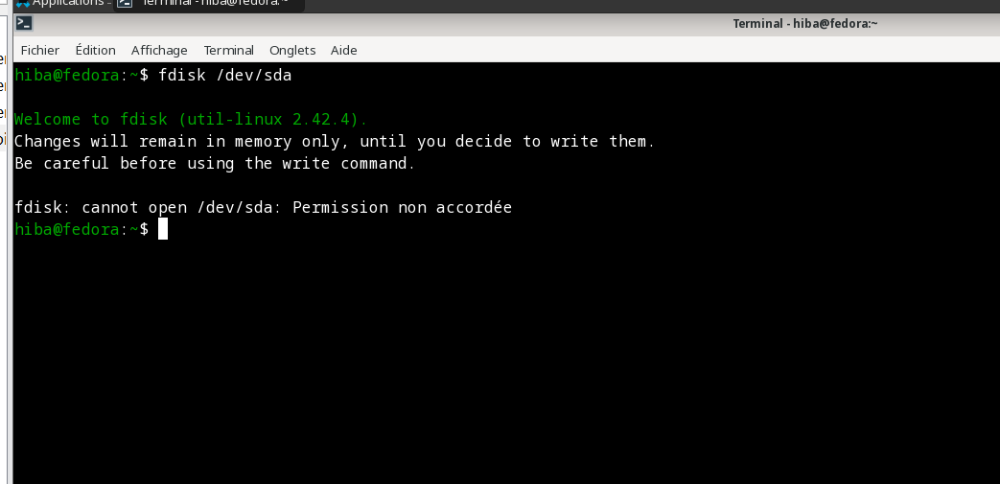
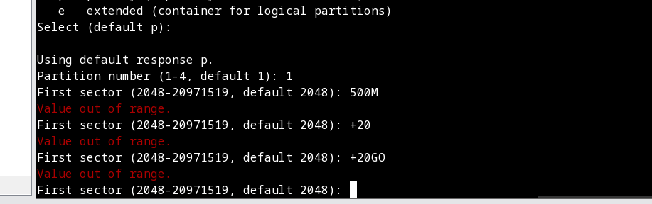
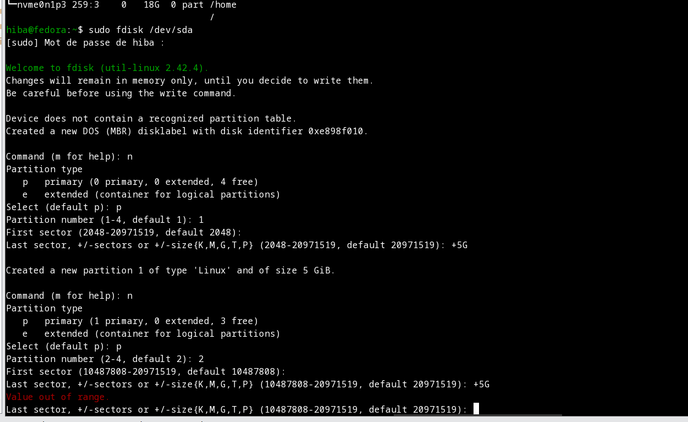
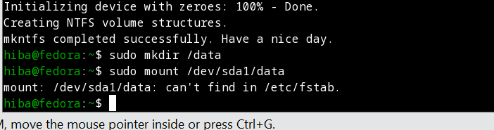
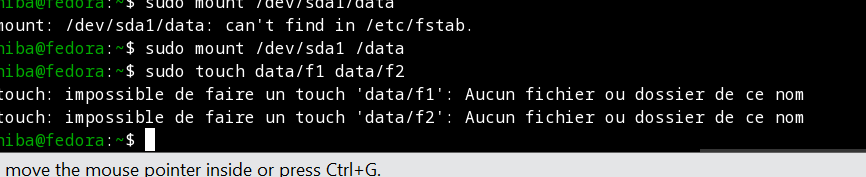
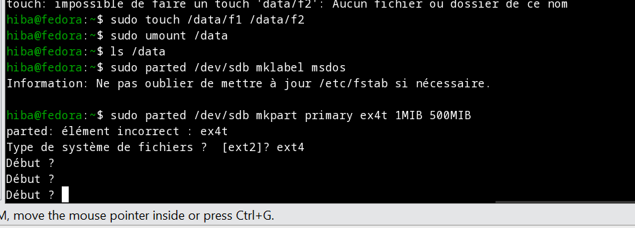
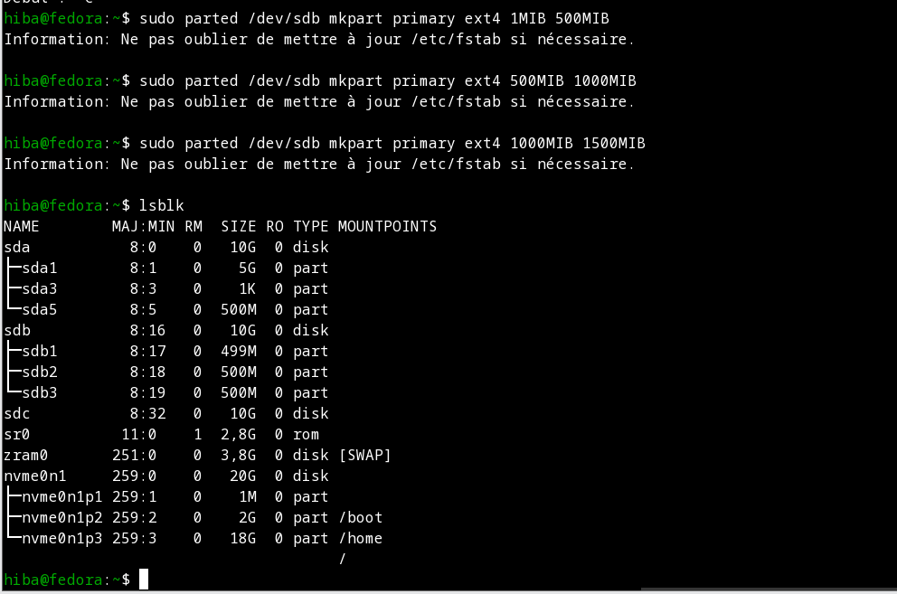
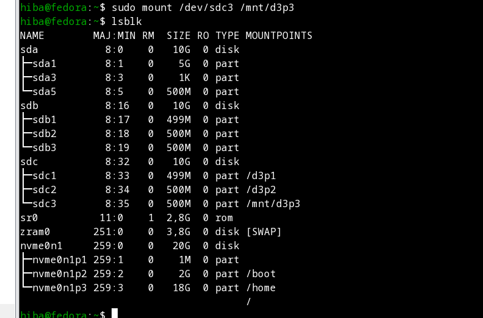
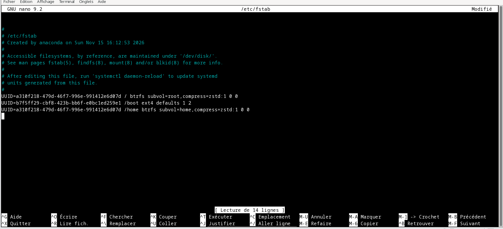
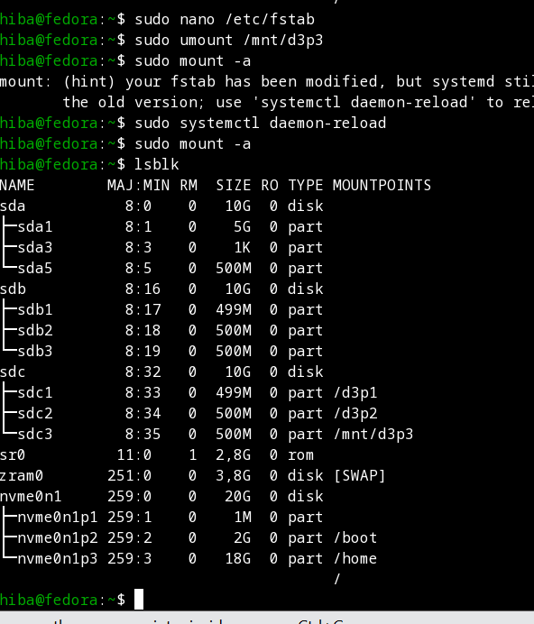
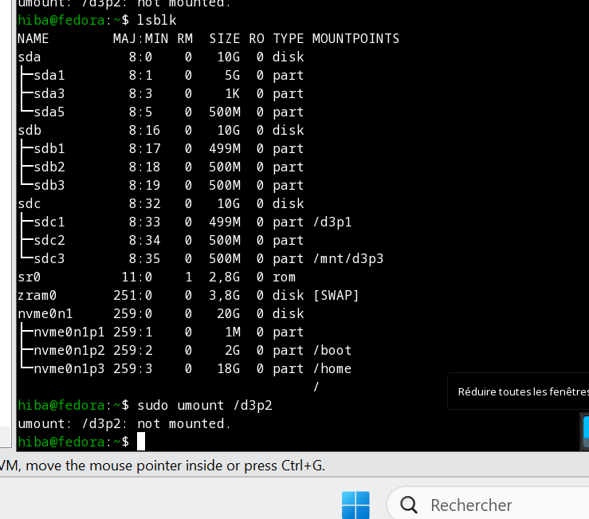
