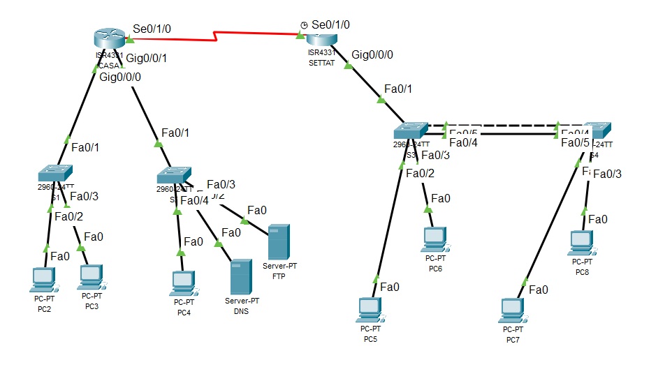

# TP — Infrastructure réseau multi-sites IPv6 : EtherChannel, VLAN, routage inter-VLAN, RIPng et DHCPv6 Stateful

## Présentation

Mise en place d'une infrastructure réseau IPv6 entre deux sites, **CASA** et **SETTAT**, dans Cisco Packet Tracer : configuration de base d'un routeur, agrégation de liens EtherChannel en PAgP, création de VLAN, routage inter-VLAN (router-on-a-stick), routage dynamique **RIPng** et attribution automatique des adresses par **DHCPv6 en mode Stateful**.



## Topologie

- **CASA** (ISR4331) : deux réseaux locaux (PC2–PC3 via S1, PC4 et serveurs DNS/FTP via S2) et la liaison série vers SETTAT.
- **SETTAT** (ISR4331) : passerelle des VLAN 35 et 36 (sous-interfaces), serveur DHCPv6.
- **S3 / S4** : commutateurs reliés par un EtherChannel (Fa0/4 + Fa0/5), PC5 à PC8 en ports access.

## Plan d'adressage IPv6

| Équipement | Interface | Adresse IPv6 | Préfixe |
|---|---|---|---|
| Routeur CASA | S0/1/0 | 2001:DB8:ABCD:24::1 | /64 |
| Routeur CASA | G0/0/0 | 2001:DB8:ABCD:21::1 | /64 |
| Routeur CASA | G0/0/1 | 2001:DB8:ABCD:20::1 | /64 |
| Routeur SETTAT | S0/1/0 | 2001:DB8:ABCD:24::2 | /64 |
| Routeur SETTAT | G0/0/0.35 (VLAN 35) | 2001:DB8:ABCD:22::1 | /64 |
| Routeur SETTAT | G0/0/0.36 (VLAN 36) | 2001:DB8:ABCD:23::1 | /64 |

## 1. Configuration de base du routeur CASA

```
enable
configure terminal
hostname Casa
enable secret CC2@2026V2
banner motd #Accès réservé uniquement au personnel autorisé#
line console 0
 password CC2@2026V2
 login
exit
service password-encryption
ipv6 unicast-routing
```

Adressage des interfaces selon le plan :

```
interface serial 0/1/0
 ipv6 address 2001:DB8:ABCD:24::1/64
 clock rate 64000
 no shutdown
interface gigabitEthernet 0/0/0
 ipv6 address 2001:DB8:ABCD:21::1/64
 no shutdown
interface gigabitEthernet 0/0/1
 ipv6 address 2001:DB8:ABCD:20::1/64
 no shutdown
```

> Le `clock rate` est configuré côté **CASA** : c'est l'extrémité DCE de la liaison série (icône horloge du schéma).

## 2. EtherChannel PAgP entre S3 et S4

Sur **chacun** des deux commutateurs :

```
interface range fastEthernet 0/4 - 5
 switchport mode trunk
 switchport nonegotiate
 channel-group 1 mode desirable
exit
interface port-channel 1
 switchport mode trunk
```

PAgP fonctionne avec le mode **desirable** aux deux extrémités. Le trunk laisse passer les VLAN 35 et 36 entre les deux commutateurs.

## 3. Création des VLAN (S3 et S4)

```
vlan 35
 name VLAN35
vlan 36
 name VLAN36
```

## 4. Affectation des ports en mode Access

```
interface fastEthernet 0/2
 switchport mode access
 switchport access vlan 35
interface fastEthernet 0/3
 switchport mode access
 switchport access vlan 36
```

Le port de S3 relié au routeur SETTAT (Fa0/1) est configuré en **trunk** pour transporter les deux VLAN vers le routeur.

## 5. Routage inter-VLAN sur SETTAT (router-on-a-stick)

```
interface serial 0/1/0
 ipv6 address 2001:DB8:ABCD:24::2/64
 no shutdown
interface gigabitEthernet 0/0/0
 no shutdown
interface gigabitEthernet 0/0/0.35
 encapsulation dot1Q 35
 ipv6 address 2001:DB8:ABCD:22::1/64
interface gigabitEthernet 0/0/0.36
 encapsulation dot1Q 36
 ipv6 address 2001:DB8:ABCD:23::1/64
```

## 6. Routage dynamique RIPng

Le processus RIPng nommé **casa-settat** est activé interface par interface (pas de commande `network` en RIPng). Le nom du processus est identique sur les deux routeurs.

**Sur CASA :**

```
interface serial 0/1/0
 ipv6 rip casa-settat enable
interface gigabitEthernet 0/0/0
 ipv6 rip casa-settat enable
interface gigabitEthernet 0/0/1
 ipv6 rip casa-settat enable
```

**Sur SETTAT :**

```
interface serial 0/1/0
 ipv6 rip casa-settat enable
interface gigabitEthernet 0/0/0.35
 ipv6 rip casa-settat enable
interface gigabitEthernet 0/0/0.36
 ipv6 rip casa-settat enable
```

## 7. DHCPv6 Stateful sur SETTAT

```
ipv6 dhcp pool VLAN35
 address prefix 2001:DB8:ABCD:22::/64
 dns-server 2001:DB8:ABCD:22::1
ipv6 dhcp pool VLAN36
 address prefix 2001:DB8:ABCD:23::/64
 dns-server 2001:DB8:ABCD:23::1
interface gigabitEthernet 0/0/0.35
 ipv6 dhcp server VLAN35
 ipv6 nd managed-config-flag
interface gigabitEthernet 0/0/0.36
 ipv6 dhcp server VLAN36
 ipv6 nd managed-config-flag
```

La commande `ipv6 nd managed-config-flag` (drapeau M) impose le mode **Stateful** : les clients demandent leur adresse au serveur DHCPv6 au lieu de se configurer par SLAAC. La passerelle, elle, est apprise automatiquement grâce aux Router Advertisements du routeur — le DHCPv6 ne distribue pas de passerelle.

## 8. Vérifications

```
show ipv6 route            ! table de routage IPv6 (question 8 du sujet)
show ipv6 route rip        ! routes apprises par RIPng (lettre R)
show ipv6 dhcp binding     ! adresses réellement attribuées aux PC
show ipv6 interface brief  ! état et adresses des (sous-)interfaces
show etherchannel summary  ! Port-channel 1 en (SU), ports membres en (P)
show interfaces trunk      ! Fa0/1 et Po1 en trunk sur S3
```

**Dépannage vécu pendant le TP :** les PC des VLAN 35/36 ne recevaient aucune adresse IPv6. Trois points de la chaîne ont été contrôlés un par un : le trunk du port de liaison vers le routeur, l'activation de `ipv6 unicast-routing` (sans elle, le routeur n'envoie aucun Router Advertisement) et le drapeau `managed-config-flag` sur les sous-interfaces. Un message `%EC-5-CANNOT_BUNDLE2` a aussi signalé un port EtherChannel suspendu à cause d'un réglage DTP différent entre Fa0/4 et Fa0/5 — corrigé en appliquant une configuration identique sur les deux ports (`switchport mode trunk` + `switchport nonegotiate` avant le `channel-group`).

## Conclusion

L'infrastructure multi-sites est fonctionnelle : les deux VLAN de SETTAT communiquent entre eux via le routage inter-VLAN, les routes IPv6 sont échangées entre CASA et SETTAT par RIPng, et les postes des VLAN 35 et 36 reçoivent automatiquement leur configuration IPv6 par DHCPv6 Stateful.
