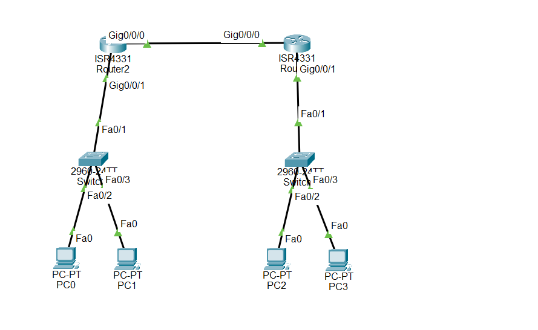

# TP — Routage dynamique RIPv2 + DHCPv4, et IPv6 (DHCPv6 + RIPng)

Topologie : 2 routeurs ISR4331 reliés par Gig0/0/0, chacun relié à un switch 2960
(Gig0/0/1 → Fa0/1), 2 PC par switch (Fa0/2 et Fa0/3).



Attention aux noms : dans Packet Tracer, le routeur affiché « Router2 » a pour
hostname **R1** (LAN1), et celui affiché « Router1 » a pour hostname **R2** (LAN2).

## Plan d'adressage

| Équipement | Interface | Adresse IP | Réseau |
|---|---|---|---|
| Routeur R1 (LAN1) | Gig0/0/0 (vers R2) | 192.168.12.1 /30 | 192.168.12.0/30 |
| Routeur R1 (LAN1) | Gig0/0/1 (vers le switch) | 192.168.10.1 /24 | 192.168.10.0/24 |
| Routeur R2 (LAN2) | Gig0/0/0 (vers R1) | 192.168.12.2 /30 | 192.168.12.0/30 |
| Routeur R2 (LAN2) | Gig0/0/1 (vers le switch) | 192.168.20.1 /24 | 192.168.20.0/24 |
| PC du LAN1 | — | DHCP (pool lan1) | 192.168.10.0/24 |
| PC du LAN2 | — | DHCP (pool lan2) | 192.168.20.0/24 |

## DHCPv4

Les deux routeurs sont serveurs DHCP pour leur propre LAN, avec la même méthode :
exclusion des adresses .1 à .20 (passerelle, serveurs), puis pool avec réseau,
passerelle par défaut et DNS 8.8.8.8.

- Pool **lan1** (routeur R1) : 192.168.10.0/24, passerelle 192.168.10.1
- Pool **lan2** (routeur R2) : 192.168.20.0/24, passerelle 192.168.20.1

## Routage RIPv2

Les deux routeurs annoncent leurs deux réseaux connectés, en version 2,
sans résumé automatique :

- Routeur R1 : `network 192.168.10.0` + `network 192.168.12.0`
- Routeur R2 : `network 192.168.20.0` + `network 192.168.12.0`

## Fichiers de configuration

- [Routeur R1 (192.168.10.0)](../reseau-cisco/ripv2-dhcpv4-routeur-lan1.txt)
- [Routeur R2 (192.168.20.0)](../reseau-cisco/ripv2-dhcpv4-routeur-R2-lan2.txt)

## Test — résultats vérifiés

**RIP (les deux routeurs apprennent le LAN distant) :**

```
R1 : R  192.168.20.0/24 [120/1] via 192.168.12.2, GigabitEthernet0/0/0
R2 : R  192.168.10.0/24 [120/1] via 192.168.12.1, GigabitEthernet0/0/0
```

120 = distance administrative de RIP, 1 = un seul saut : le routage fonctionne
dans les deux sens.

**DHCP (baux distribués, tous hors de la plage exclue .1–.20) :**

```
LAN1 : 192.168.10.21 et 192.168.10.22 (Automatique)
LAN2 : 192.168.20.21 et 192.168.20.22 (Automatique)
```

Soit 2 PC par LAN, comme sur la topologie.

**Interfaces :** toutes les interfaces utilisées sont up/up ; les Gig0/0/2
inutilisées sont administratively down, ce qui est normal.

## IPv6 — DHCPv6 stateful + RIPng (même maquette)

Même topologie, en IPv6. Les deux routeurs font `ipv6 unicast-routing` et
sont serveurs DHCPv6 **stateful** pour leur LAN (le serveur attribue aussi
l'adresse, d'où le flag **M** = `ipv6 nd managed-config-flag` sur l'interface
LAN). Le routage IPv6 est assuré par **RIPng** (`ipv6 rip TPRIP enable` sur
toutes les interfaces).

| Équipement | Interface | Adresse IPv6 |
|---|---|---|
| Routeur R1 | Gig0/0/0 | 2001:db8:10::1/64 — ⚠️ voir remarque ci-dessous |
| Routeur R1 | Gig0/0/1 | 2001:db8:12::1/64 |
| Routeur R2 | Gig0/0/0 | 2001:db8:12::2/64 |
| Routeur R2 | Gig0/0/1 | 2001:db8:20::1/64 |

- Pool **lan1** (R1) : préfixe 2001:db8:10::/64, DNS 2001:4860::8888
- Pool **lan2** (R2) : préfixe 2001:db8:20::/64, DNS 2001:4860::8888

Fichiers de configuration IPv6 :

- [Routeur R1 — DHCPv6 + RIPng](../reseau-cisco/ripng-dhcpv6-routeur-R1.txt)
- [Routeur R2 — DHCPv6 + RIPng](../reseau-cisco/ripng-dhcpv6-routeur-R2.txt)

⚠️ **Remarque à vérifier sur R1 :** sur les captures, l'adresse LAN
(2001:db8:10::1) avec le serveur DHCP lan1 et le flag managed sont configurés
sur **Gig0/0/0**, alors qu'en IPv4 le LAN de R1 est sur **Gig0/0/1** (et la
liaison sur Gig0/0/0). Si la topologie n'a pas changé, le serveur DHCPv6 se
trouve du côté du câble inter-routeur au lieu du switch : les PC du LAN1 ne
recevraient alors pas d'adresses du pool lan1. Vérifier s'il ne s'agit pas
d'une inversion g0/0/0 ↔ g0/0/1 avant de considérer cette partie comme terminée.

Petites erreurs corrigées immédiatement, sans conséquence : sur R2, le premier
`address prefix` a été tapé avec l'adresse du DNS (2001:4860::8888) au lieu du
préfixe, puis corrigé en 2001:db8:20::/64 ; sur R1, la première tentative de
`address prefix` a aussi été rejetée puis retapée correctement.

## Vérification

```
show ip route          ! routes R apprises par RIP (AD 120)
show ip route rip      ! uniquement les routes RIP
show ip protocols      ! RIP version 2, réseaux annoncés
show ip rip database
show ip dhcp binding   ! baux distribués
show ip interface brief ! état des interfaces
ping                   ! d'un PC d'un LAN vers un PC de l'autre LAN
```

Astuce : en mode configuration, il faut taper `do` devant les commandes
`show` (ex. : `do show ip route`), sinon le routeur répond
« Invalid input detected ».
