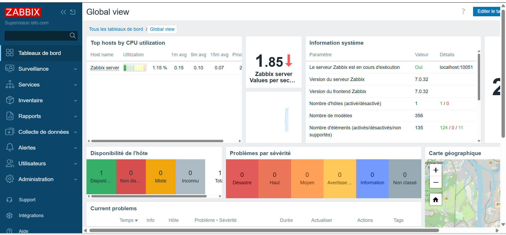
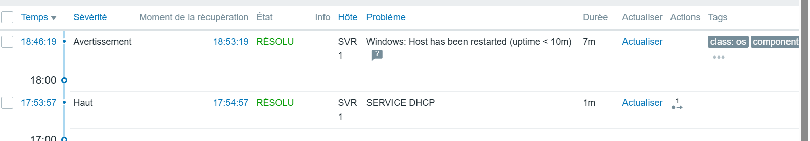
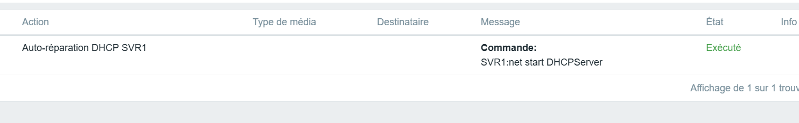

# TP 16 — Supervision du lab isfo.com avec Zabbix et auto-réparation d'un service

## Objectif

Mettre en place une **vraie supervision** de mon laboratoire Active Directory **isfo.com** avec **Zabbix 7.0** : un serveur de supervision dédié, des agents sur les contrôleurs de domaine, la surveillance des services critiques (AD DS, DNS, DHCP, DFS), un tableau de bord du parc pensé pour rester affiché en permanence chez l'administrateur, et une **auto-réparation** : Zabbix redémarre tout seul le service DHCP de SVR1 lorsqu'il s'arrête, sans intervention humaine.

## Environnement

| Élément | Détail |
|---|---|
| VM de supervision | **SRV-SUP** — Ubuntu Server 24.04.5 LTS, 2 Go de RAM, nom d'hôte `svr-ubuntu` |
| Adresse de SRV-SUP | **192.168.1.53/24** sur le réseau du lab (VMnet1 Host-only), 2ᵉ carte NAT pour Internet |
| Supervision | **Zabbix Server 7.0.32** + MariaDB 10.11, interface web : http://192.168.1.53/zabbix |
| Nom du serveur Zabbix | « Supervision isfo.com », fuseau horaire Africa/Casablanca |
| Machines supervisées | **SVR1** (192.168.1.113) et **SVR_2** (192.168.1.50), contrôleurs de domaine isfo.com |
| Agents | Zabbix Agent 2 **7.0.32** (Windows), modèle « Windows by Zabbix agent active », groupe d'hôtes « Lab isfo.com » |

## Phase 1 — Installation du serveur Zabbix (19/11/2026)

1. Création de la VM **SRV-SUP** sous VMware : carte 1 = Host-only (lab), carte 2 = NAT (Internet). Configuration réseau statique par Netplan (`/etc/netplan/99-lab.yaml`) : `ens33 = 192.168.1.53/24`.
2. Installation de **MariaDB**, création de la base `zabbix` (utf8mb4) et de l'utilisateur dédié, avec `log_bin_trust_function_creators = 1` pour l'import du schéma.
3. Installation depuis le dépôt officiel : `zabbix-server-mysql`, `zabbix-frontend-php`, `zabbix-apache-conf`, `zabbix-sql-scripts`, `zabbix-agent2` → **Zabbix 7.0.32**.
4. Import du schéma SQL, mot de passe de la base renseigné dans `zabbix_server.conf` (`DBPassword=`), puis démarrage et activation des services : `zabbix-server`, `zabbix-agent2`, `apache2`.
5. Assistant web : nom du serveur « Supervision isfo.com », fuseau **Africa/Casablanca**. Première connexion réussie : serveur « en cours d'exécution », 0 problème.

## Phase 2 — Agents sur SVR1 et SVR_2 (19/11/2026)

- L'installeur MSI de l'Agent 2 est hébergé temporairement par SRV-SUP (`python3 -m http.server`) et téléchargé depuis chaque serveur Windows avec `curl -O` (**-O majuscule**).
- Paramètres de l'agent : nom d'hôte exact (**SVR1** / **SVR2** — sensible à la casse pour les contrôles actifs), serveur Zabbix **192.168.1.53**, port 10050, serveur pour contrôles actifs = 192.168.1.53.
- Création des hôtes dans Zabbix avec le modèle **« Windows by Zabbix agent active »** : SVR1 → **ZBX vert, 53 éléments, 10 graphiques** ; SVR2 → **ZBX vert, 34 éléments, 5 graphiques**.
- **Premier test réel** : extinction de SVR1 → Zabbix détecte seul l'arrêt (ZBX rouge, problème remonté). La supervision fonctionne.

## Phase 3 — Surveillance des services critiques (19/11/2026)

Création manuelle de **4 éléments** sur SVR1 (type Agent Zabbix, intervalle 1 minute), avec la clé `service.info[...]` — valeur **0 = service démarré**, **6 = service arrêté** :

| Élément | Clé | Déclencheur | Sévérité |
|---|---|---|---|
| SERVICE DNS | `service.info[DNS]` | `last(/SVR1/service.info[DNS])<>0` | Haute |
| SERVICE DHCP | `service.info[DHCPServer]` | `last(/SVR1/service.info[DHCPServer])<>0` | Haute |
| SERVICE AD DS | `service.info[NTDS]` | `last(/SVR1/service.info[NTDS])<>0` | Non classé |
| SERVICE DFS | `service.info[DFSR]` | `last(/SVR1/service.info[DFSR])<>0` | Non classé |

## Phase 4 — Tableau de bord du parc (20/11/2026)

Création et sauvegarde du tableau de bord **« Parc isfo.com »**, conçu pour rester ouvert en permanence :

- **Problèmes** du groupe Lab isfo.com (toutes sévérités, actualisation 1 min)
- **Disponibilité des hôtes** (contrôles actifs)
- **Horloge** Africa/Casablanca
- **Graphiques CPU** de SVR1 et de SVR2
- **Problèmes par sévérité**

## Phase 5 — Auto-réparation du service DHCP (20/11/2026)

Objectif : quand le service DHCP de SVR1 s'arrête, Zabbix le redémarre **tout seul**, avec une sécurité stricte — l'agent n'est autorisé à exécuter qu'**une seule commande** (liste blanche).

1. **Autorisation limitée sur l'agent de SVR1** (`zabbix_agent2.conf`) :
   `AllowKey=system.run[net start DHCPServer,*]`
2. **Script Zabbix** « Redémarrer le service DHCP » (Alertes → Scripts) : commande `net start DHCPServer`, exécuté sur l'agent, étendue « action d'opération ».
3. **Action automatique** « Auto-réparation DHCP SVR1 » (Alertes → Actions) : condition = déclencheur **SVR1: SERVICE DHCP**, opération = exécuter le script sur l'hôte actuel, état **Activé**.

### Test réel — réussi, résolution en 1 minute

Arrêt manuel du service DHCP sur SVR1, puis **aucune intervention** :

- **17:53:57** — le problème « SERVICE DHCP » se déclenche (sévérité Haute)
- L'action exécute le script : Journal des actions → « Auto-réparation DHCP SVR1 — Commande: SVR1:net start DHCPServer — État : **Exécuté** »
- **17:54:57** — problème **RÉSOLU**. Durée totale : **1 minute**, sans toucher à rien.

## Pièges rencontrés et leçons

- **`LogRemoteCommands` n'existe pas dans l'Agent 2** (paramètre de l'Agent 1) : une seule ligne invalide dans le fichier de configuration et l'agent refuse de démarrer (erreur 1053). Supprimer la ligne a tout rétabli.
- **Déclencheur inversé** : mon déclencheur DHCP testait `=0` (alerte quand le service *tourne*). L'expression correcte est `<>0`. Symptôme trompeur : les données remontaient parfaitement (valeur 6 = arrêté), mais aucune action ne partait.
- **La virgule de l'AllowKey** : `system.run[net start DHCPServer*]` (étoile collée) est refusé — l'agent retombe alors sur le refus par défaut (`Unknown metric system.run`). La forme correcte sépare la commande et le paramètre d'attente par une virgule : `system.run[net start DHCPServer,*]`. Vérifié par le test local de l'agent : `[s|1]`.
- **`curl -O` majuscule** sous Windows : avec `-o` minuscule, curl attend un nom de fichier et refuse l'URL.
- **Nom d'hôte sensible à la casse** : pour les contrôles actifs, le nom déclaré dans l'agent doit correspondre exactement à celui de l'hôte Zabbix (`SVR2`, pas `svr2`).
- Le service Linux s'appelle **`zabbix-server`** (avec le tiret).

## Résultat

Le lab isfo.com est supervisé en continu : disponibilité des deux contrôleurs de domaine, état des services AD DS, DNS, DHCP et DFS, tableau de bord du parc — et un premier cas d'**auto-réparation prouvé en conditions réelles** : un service critique arrêté est redémarré automatiquement en 1 minute. C'est exactement le principe de la maintenance préventive : détecter, proposer, et réparer les cas simples sans attendre l'administrateur.

## Reste à faire

- Notifications par e-mail (SMTP Gmail) à la création et à la résolution des problèmes
- Réactivation de l'agent de SVR_2 (ZBX gris depuis sa re-promotion en contrôleur de domaine inscriptible)
- Changement du mot de passe Admin par défaut de Zabbix
- Affichage du tableau de bord en mode kiosque plein écran
- Agent sur le poste client du lab
